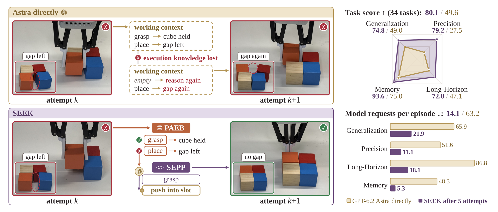

<h1 align="center">SEEK</h1>

<p align="center">
  <b>Self-Evolution through Execution Knowledge for Agentic Robot Manipulation</b>
</p>

<p align="center">
  <i>Execution knowledge accumulates; the model stays fixed.</i>
</p>

<p align="center">
  <a href="https://arxiv.org/abs/2611.33915"></a>
  <a href="https://zeyangguan.github.io/SEEK-Agentic-Robot-Manipulation/"></a>
  <a href="evaluation/k5-frozen-seed2/"></a>
  <a href="LICENSE"></a>
</p>

<p align="center">
  <a href="https://zeyangguan.github.io/SEEK-Agentic-Robot-Manipulation/"></a>
</p>

<p align="center">
  <a href="#overview">Overview</a> ·
  <a href="#results">Results</a> ·
  <a href="#how-it-works">How it works</a> ·
  <a href="#installation">Installation</a> ·
  <a href="#usage">Usage</a> ·
  <a href="#experimental-setting">Experimental setting</a> ·
  <a href="docs/METHOD.md">Method ↔ code</a>
</p>

## Overview

SEEK lets a robot improve at a manipulation task by attempting it repeatedly,
with no fine-tuning, no demonstrations, and no change to the underlying model.
What changes between attempts is the **execution knowledge** the robot keeps:

- **SEPP** (Self-Evolving Programmatic Policy) encodes manipulation as
  executable procedures: a main program and a set of named, reusable operations
  that determine each action from the current observation.
- **PAEB** (Persistent Action-Effect Bank) records every executed action together
  with the state measured before and after it, including actions from failed
  attempts.

A fixed general-purpose multimodal model is called only when a procedure requests
help or execution stalls: to interpret a scene, to propose action candidates, or
to revise the procedures. As the procedures mature, more of each attempt runs
locally and fewer model requests are needed.

This repository contains the SEEK runtime for dual-arm manipulation from
calibrated RGB observations, the post-attempt review, and the configuration used
in the paper.

## Results

RoboDojo, 34 dual-arm manipulation tasks in four categories (all tasks outside the
Open category), with `gpt-6.2-astra` at reasoning effort `xhigh` as the fixed
model. SEEK evolves its execution knowledge over five attempts per task
($\mathcal K_5$) and is then evaluated with that knowledge frozen. The baseline is
the same model acting directly through the benchmark team's reference harness.
Both are scored on the same 340 episodes, 10 per task, on layouts unseen during
evolution. Each entry is task score / success rate (%).

| `gpt-6.2-astra` | Average | Generalization | Precision | Long-Horizon | Memory | Requests / episode |
|---|---|---|---|---|---|---|
| Acting directly | 49.6&nbsp;/&nbsp;40.7 | 49.0&nbsp;/&nbsp;44.2 | 27.5&nbsp;/&nbsp;17.5 | 47.1&nbsp;/&nbsp;26.2 | 75.0&nbsp;/&nbsp;75.0 | 63.2 |
| **SEEK** ($\mathcal K_5$) | **80.1&nbsp;/&nbsp;75.0** | **74.8&nbsp;/&nbsp;69.2** | **79.2&nbsp;/&nbsp;75.0** | **72.8&nbsp;/&nbsp;62.5** | **93.6&nbsp;/&nbsp;93.3** | **14.1** |

With the same model, SEEK raises the average task score from 49.6 to 80.1 and
uses 77.6% fewer model requests. The seed, layout, score and model requests of
every episode are in [`evaluation/k5-frozen-seed2`](evaluation/k5-frozen-seed2/)
for SEEK and [`evaluation/astra-direct-seed2`](evaluation/astra-direct-seed2/) for
the model acting directly, and on the
[project page](https://zeyangguan.github.io/SEEK-Agentic-Robot-Manipulation/#log).

## How it works

**Within an attempt**, every control step follows the same loop.

| Step | What happens | Main module |
|---|---|---|
| **Observe** | Three RGB views, camera calibration, and robot state are read, and tracked image regions are updated. There is no depth input and no privileged scene state. | [`rgb_perception.py`](runtime/seek/policy/rgb_perception.py), [`unified_vision.py`](runtime/seek/policy/unified_vision.py) |
| **Decide** (SEPP) | The active procedure runs `decide(ctx, state)`. It returns an action, selects an operation, consumes a candidate proposed by the model, or asks the model for help. | [`mechanism_program.py`](runtime/seek/policy/mechanism_program.py), [`operation_knowledge.py`](runtime/seek/policy/operation_knowledge.py) |
| **Execute** | The action is checked against the motion limits and dispatched for one physical step. An execution receipt records the command that was actually sent and the robot state before and after it. | [`motion_query.py`](runtime/seek/policy/motion_query.py), [`execution_receipt.py`](runtime/seek/policy/execution_receipt.py) |
| **Record** (PAEB) | The transition, its context, and its provenance are appended to the bank. Procedures and the model retrieve records by ID, text query, attempt, or record type. | [`experience_access.py`](runtime/seek/policy/experience_access.py) |

A fixed progress monitor checks the receipts for sustained lack of motion,
oscillation, and weak response to commanded motion, and requests a model review
when one of them occurs
([`execution_progress.py`](runtime/seek/policy/execution_progress.py)).
The model can then revise the main program or individual operations online. The
runtime validates the new code and stores it as a new version.

**Across attempts**, two updates are applied.

1. **Evidence accumulation.** The attempt's transitions, assessments, and outcome
   are appended to PAEB. Earlier records are never overwritten.
2. **Policy consolidation.** After the attempt, the model reviews the outcome and
   the trace. It chooses to *keep*, *replace*, or *revert* the main program, and
   it can update or restore individual operations
   ([`tools/review.py`](runtime/tools/review.py)).

Every attempt starts from a fresh scene. Scene-dependent state such as object
bindings, targets, and the current stage is rebuilt from the new observations;
procedures and evidence carry over.

[docs/METHOD.md](docs/METHOD.md) maps the paper's notation to modules, data
structures, and limits.

## Repository layout

```
runtime/
  seek/             launcher, simulator adapter, and policy server
  seek/policy/      SEPP interpreter, PAEB access, RGB perception, model interface
  tools/            post-attempt review
  configs/          harness settings, the SEEK protocol profile, task specifications,
                    and dependency locks
  setup/            installers, requirements, and the RoboDojo integration patch
  tests/            offline tests (no simulator, no model requests)
docs/
  METHOD.md         method ↔ code
  SETUP.md          installation and running attempts
web/, index.html    project page
packages/           source archive, with digests in SOURCE_MANIFEST.json
```

## Installation

Requirements:

- Linux with an NVIDIA GPU supported by Isaac Sim 5.1;
- three Python environments, for the simulator, the policy, and SAM 3
  segmentation;
- Git and Git LFS;
- an endpoint of the Responses API with streaming for the fixed model, and the
  SAM 3 checkpoint.

From `runtime/`:

```bash
python setup/prepare.py
/path/to/policy/bin/pip install -r setup/requirements-policy.txt
/path/to/sim/bin/pip install -r setup/requirements-sim.txt -c setup/constraints-sim.txt
/path/to/policy/bin/python setup/fetch_assets.py --data-root /path/to/data --cache /path/to/asset-cache
cp setup/seek.env.example setup/seek.env
```

`prepare.py` clones the pinned third-party packages and applies the SEEK
integration patch to RoboDojo. Set the paths in `setup/seek.env`, source it, and set
`SEEK_MODEL_KEY` and `SEEK_MODEL_ENDPOINT` in the same shell. Details are in the
[setup guide](docs/SETUP.md).

The offline tests run without the simulator or the model:

```bash
cd runtime/tests
PYTHONPATH=.. "$SEEK_POLICY_PYTHON" -m unittest discover -p 'test_*.py'
```

## Usage

One attempt reads a knowledge snapshot and writes the next one. Attempt 1 of a
task starts from an empty snapshot ($\mathcal K_0$):

```bash
export RUN_ROOT=/path/to/new/run
mkdir "$RUN_ROOT"
cp configs/protocols/seek.json "$RUN_ROOT/profile.json"

export SEEK_MEMORY="$RUN_ROOT/memory_0.json"
export SEEK_OUTPUT="$RUN_ROOT/memory_1.json"
export SEEK_EPISODE=1

"$SEEK_POLICY_PYTHON" -c "
import json, os
from seek.policy.execution_policy import empty_memory
open(os.environ['SEEK_MEMORY'], 'w').write(json.dumps(empty_memory('deposit_coin')))"

"$SEEK_POLICY_PYTHON" -m seek.run deposit_coin --seed 0 --layout 1 \
  --profile "$RUN_ROOT/profile.json" --results-root "$RUN_ROOT/episode_1"
```

The [setup guide](docs/SETUP.md) covers the post-attempt review, chaining
attempts into an evolution run, and evaluating a snapshot on unseen layouts.

## Experimental setting

The released configuration is the one used for the results above.

| Setting | Value | Where it is set |
|---|---|---|
| Fixed model | `gpt-6.2-astra`, reasoning effort `xhigh`, no parameter updates | [`configs/protocols/seek.json`](runtime/configs/protocols/seek.json) |
| Model requests | not capped | `max_model_requests: null` |
| Observations | RGB from a head camera and two wrist cameras (640×480), proprioception, camera calibration; no depth, no privileged object state | [`model_policy.py`](runtime/seek/policy/model_policy.py), [`benchmark.py`](runtime/seek/benchmark.py) |
| Actions | end-effector increments and gripper targets for both arms | [`configs/shared_harness.json`](runtime/configs/shared_harness.json) |
| Candidate plan length | set by the task's native step limit | [`prediction_horizon.py`](runtime/seek/policy/prediction_horizon.py) |
| Demonstrations | none | — |
| Evolution | 5 attempts on distinct seed-0 layouts, starting from $\mathcal K_0$, with a review after each attempt | [docs/SETUP.md](docs/SETUP.md#chain-attempts) |
| Evaluation | 10 episodes per task on seed-2 layouts (standard 1–5 and randomized 1–5 for Generalization tasks, standard 1–10 otherwise); each episode starts from a fresh copy of the snapshot, may revise procedures online, and writes nothing back | `SEEK_FREEZE_LEARNING=1`, `SEEK_EPISODE_ADAPTATION=1` |
| Baseline | the same model acting directly through the reference harness of RoboProbe (`RoboDojo_Agent_L3_Inspect_EEF`), on the same episodes, with no knowledge | [`evaluation/astra-direct-seed2`](evaluation/astra-direct-seed2/) |

## Citation

If you find SEEK useful, please cite the [paper](https://arxiv.org/abs/2611.33915):

```bibtex
@article{guan2026seek,
  title   = {{SEEK}: Self-Evolution through Execution Knowledge
             for Agentic Robot Manipulation},
  author  = {Guan, Zeyang and Zhao, Qihao and Gong, Rui and Zhang, Haitian and
             Dai, Yalun and Huang, Yangyu and Xiao, Lingao and Du, Haozhe and
             Yu, Xuehui and Lu, Ye and Gao, Jianjun and Wang, Ruoyu and
             Bai, Haowen and Li, Hao and Li, Scarlett and Yap, Kim-Hui},
  journal = {arXiv preprint arXiv:2611.33915},
  year    = {2026}
}
```

## License

The SEEK source is released under the [MIT License](LICENSE). Third-party
packages installed by `setup/prepare.py` keep their own licenses.

## Acknowledgements

SEEK is evaluated on the RoboDojo benchmark and runs on Isaac Sim, Isaac Lab,
XPolicyLab, and cuRobo. Image segmentation uses SAM 3.
